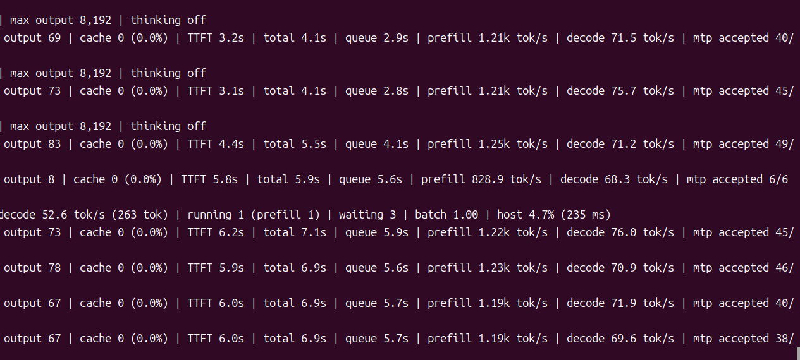

**中文 README** | [English README](README.en.md)

# ninfer-for-index-translate-9b-4060

在 **RTX 4060（8 GB 显存）** 上运行 **Index-Translate-9B** 翻译模型的推理引擎仓库：NInfer fusion engine + KVMem 主机 KV 环（host-backed KV ring），提供 OpenAI 兼容的 `/v1/chat/completions` HTTP 服务。

## 代码来源与魔改说明

- 本仓库代码来源于上游两个仓库：
  - [ruwwww/ninfer-5060ti](https://github.com/ruwwww/ninfer-5060ti)
  - [1314521gjy/ninfer-fusion-kvmem](https://github.com/1314521gjy/ninfer-fusion-kvmem)（源码快照 `9a5a920`，本仓库以它为基底）
- 在上游基础上使用 **qwen3.8-flash** 进行魔改，主要本地改动包括：
  - Q4 / Q5 / Q6 / Q8 linear 新形状（shape）kernel
  - causal_cache attention 的 `small_t` i8 `h16v4` append/cached kernel（w1/w2/w3）
  - Qwen3.5 / Qwen3.8 `flash_next` GDN（ gated delta net）与 MTP 修复
  - 8 GB 卡的 KV 配置与启动脚本（本仓库根目录 `start-*.sh`）

## 模型

模型工件（`.ninfer` 格式，约 6.5 GB）托管在 Hugging Face：

**https://huggingface.co/snowen/index-translate-9b-ninfer**

- 基座模型：[IndexTeam/Index-Translate-9B](https://huggingface.co/IndexTeam/Index-Translate-9B)
- 任务：翻译（EN ⇄ ZH），License: Apache-2.0
- 需要的文件：`index_translate_9b_v3.ninfer`、`index_chat_template.jinja`

模型不含在本仓库中，需要单独下载（见下面「运行方法」）。

## 安装 / 编译方法

### 依赖（Linux，本机实测组合）

| 组件 | 版本 |
|---|---|
| NVIDIA 驱动 | ≥ 580（CUDA 13.x 硬要求） |
| CUDA Toolkit (nvcc) | 13.0（实测）；CUDA 13.x 不支持 Volta/sm_70 |
| CMake | ≥ 3.25（实测 3.28.3） |
| Ninja | 任意新版 |
| libcurl、ffmpeg 开发头 | Ubuntu 上 `libcurl-dev`、`libavcodec-dev libavformat-dev libavutil-dev libswscale-dev`（走 pkg-config，无需 vcpkg） |

Windows 需要 vcpkg（manifest 已钉 `curl`、`ffmpeg[zlib]`、`pkgconf`），完整流程见 [`src/编译指南-怎么编.md`](src/编译指南-怎么编.md)。

### 编译

```bash
# 架构必须显式指定：sm_89 = RTX 40 系/Ada, sm_86 = RTX 30 系, sm_120a = RTX 50 系
cmake -S src-tree/fusion-engine-src -B build-89 -G Ninja \
  -DCMAKE_BUILD_TYPE=Release \
  -DCMAKE_CUDA_ARCHITECTURES=89 \
  -DNINFER_BUILD_APPS=ON -DBUILD_TESTING=OFF -DNINFER_BUILD_BENCHMARKS=OFF

cmake --build build-89 --target ninfer-serve -j 8
```

产物：`build-89/apps/ninfer-serve`（首次全量构建约 1–2 小时，`-j 8` 是针对 ptxas 内存的建议值）。

### 下载模型

```bash
hf download snowen/index-translate-9b-ninfer index_translate_9b_v3.ninfer index_chat_template.jinja --local-dir .
# 或: huggingface-cli download snowen/index-translate-9b-ninfer index_translate_9b_v3.ninfer index_chat_template.jinja --local-dir .
```

## 运行方法

```bash
./build-89/apps/ninfer-serve ./index_translate_9b_v3.ninfer \
  --device 0 \
  --host 127.0.0.1 --port 8099 --chat-template index_chat_template.jinja \
  --max-context 4096 --max-concurrency 8 --no-prefix-reuse \
  --kv-dtype k8v4 \
  --spec mtp --draft-tokens 2 --adaptive-mtp \
  --no-thinking \
  --device-profile auto \
  --no-cuda-graph
```

也可以直接使用根目录的启动脚本（如 [`start-9b.sh`](start-9b.sh)，需要把其中 `MODEL` 路径改为下载的工件文件名）。

验证服务：

```bash
curl http://127.0.0.1:8099/v1/chat/completions \
  -H 'Content-Type: application/json' \
  -d '{"model":"index_translate_9b_v3","messages":[{"role":"user","content":"Translate to English: 今天天气不错"}],"max_tokens":256}'
```

（不传 `--model-id` 时，公开模型名取自定义工件的 metadata.name。）

实测演示截图（RTX 4060 8 GB，decode ~70 tok/s，MTP 接受率 40+/45）：



## 注意事项

1. **一个 GPU 架构一个干净构建目录**。不同时期的 `.obj` 混进同一次链接会做出启动即崩的二进制（`0xC0000005 @ 0x18c729`）。换架构/回滚版本后必须删掉 `.obj` 或换新目录，见 [`src/根因与修法-0x18c729-20261003.md`](src/根因与修法-0x18c729-20261003.md)。
2. **不要用 sccache 包 nvcc**（实测会让 `fatbinary` 找不到中间 `.ptx`）；要缓存只给 C/CXX 加。
3. **8 GB 显存靠 `--kv-dtype k8v4`（fp8 keys + nvfp4 values）与 `--device-profile auto`**：这是 RTX 4060 8 GB 档的关键组合；bf16 小上下文档可参考 [`start-9b-bf16.sh`](start-9b-bf16.sh)。
4. **同一张卡一次只能跑一个服务**，启动前先停掉旧服务。
5. 编译不需要模型权重；本仓库不含任何权重、编译产物与日志（`build-*/`、`*.log`、二进制等均被 `.gitignore` 排除）。
6. 更多背景与实测记录见 `src/` 下的文档：`复现白皮书-NInfer-KVMem环-20261002.md`、`编译指南-怎么编.md`、`8G档-配置提醒-20261008.md`、`我方-新增能力与已解决问题.md`。

## License

上游代码与其 LICENSE/NOTICE 保持一致，见 [`src/LICENSE`](src/LICENSE)、[`src/NOTICE.md`](src/NOTICE.md)；模型为 Apache-2.0。
